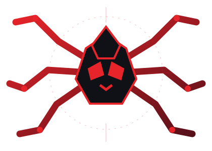

 

### `YOUR FRIENDLY NEIGHBORHOOD DEVELOPER`

**Computer Science Student · AI & ML · Full-Stack Developer**

Building useful things, experimenting with AI, and shipping projects one commit at a time.

---

## 🕷️ About Me

- 🎓 B.Tech student focused on **Computer Science, AI & Machine Learning**.
- 💻 Building full-stack applications with **React, TypeScript, Node.js, and databases**.
- 🤖 Exploring **AI/ML and Generative AI** through practical projects.
- 🚀 I enjoy turning rough ideas into useful products.
- 🕸️ Learn by building, breaking, debugging, and shipping.

## ⚡ Current Missions

| Project | Mission | Status |
|:--|:--|:--:|
| **IPOTrack** | Making IPO information and allotment tracking easier to follow. | `In progress` |
| **Niyama** | Exploring herbal wellness through AI-powered experiences. | `Building` |

## 🧪 Featured Builds

<table>
<tr>
<td width="50%" valign="top">
<h3>🕸️ Campus Buddy</h3>
A campus companion with PG discovery, community, FAQs, and a student resource hub.
  
<strong>🏆 3rd place</strong> — 24-hour hackathon
  
<a href="https://github.com/VvkChoudhary04/Campus-Buddy">View repository ↗</a>
</td>
<td width="50%" valign="top">
<h3>🧠 AskMyNotes</h3>
A notes-focused project built to make learning resources easier to work with.
  
<a href="https://github.com/VvkChoudhary04/AskMyNotes">View repository ↗</a>
</td>
</tr>
</table>

<a href="https://github.com/VvkChoudhary04?tab=repositories">Explore all repositories →</a>

## 🧰 My Tech Arsenal

**Languages**

**Frontend**

**Backend & Databases**

**Tools**

**AI**

`AI / ML` · `Generative AI APIs` · `Prompt Engineering`

## 🏆 Achievements

- 🥇 **International Rank 17** — IMO Phase 1.
- 🌍 **International Rank 905** — IMO Phase 2.
- 🏆 **3rd place** — 24-hour hackathon for Campus Buddy.

## 🐍 GitHub Activity

<!-- Contribution snake is published by the contribution-snake workflow. -->
<picture>
  <source media="(prefers-color-scheme: dark)" srcset="https://raw.githubusercontent.com/VvkChoudhary04/VvkChoudhary04/output/github-contribution-grid-snake-dark.svg" />
  <source media="(prefers-color-scheme: light)" srcset="https://raw.githubusercontent.com/VvkChoudhary04/VvkChoudhary04/output/github-contribution-grid-snake.svg" />
  
</picture>

 

---

**“With great code comes great responsibility.”**

Thanks for stopping by · 

